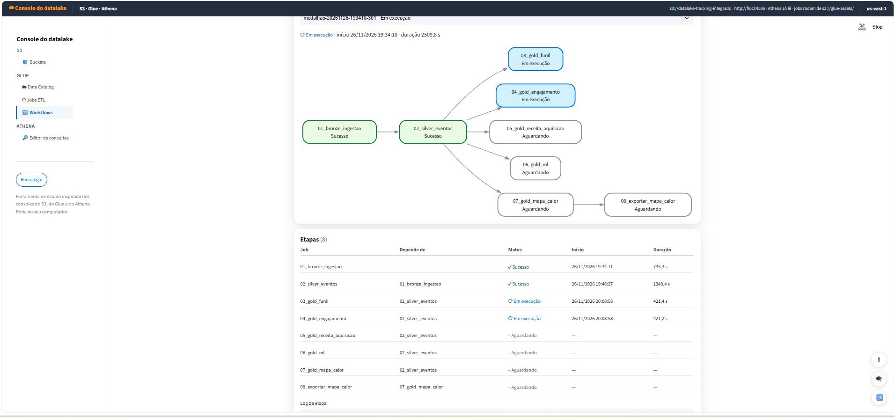

# RELATÓRIO — DADOSPRO

**Projeto:** Datalake de tracking da DadosPro — Formação em Análise de Dados  
**Período analisado:** 01/09/2026 a 14/09/2026  
**Armazenamento:** Floci (S3 emulado), bucket `datalake-tracking-integrado`  
**Processamento:** PySpark 4.2.0

## 1. Resumo executivo

Foi implementado um pipeline de dados em arquitetura medalhão, com ingestão da landing em JSON Lines, armazenamento em Parquet, tratamento e validação na Silver e geração de tabelas analíticas na Gold.

A execução sequencial integrada concluiu os oito jobs com sucesso em **2.709,84 segundos (45min09,84s)**. A auditoria posterior confirmou a presença das 15 tabelas Gold previstas nesta implementação, todas com registros.

A base processada contém **64.372 eventos na Bronze**, dos quais **63.716 permaneceram após deduplicação**. Na Silver, **61.813 eventos foram aceitos** e **1.903 rejeitados por regras de qualidade**. Foram identificadas **8.793 sessões** e extraídos **24.427 itens**.

## 2. Funil de conversão

**Tabela principal:** `gold/funil_compra`  
**Tabela complementar:** `gold/funil_lead`

O funil de compra foi modelado pelas etapas `view_item_list`, `select_item`, `add_to_cart`, `view_cart`, `begin_checkout`, `add_payment_info` e `purchase`.

| Etapa | Sessões | Conversão sobre a etapa anterior | Conversão sobre o topo |
|---|---:|---:|---:|
| Visualização da lista (`view_item_list`) | 5.258 | — | 100,00% |
| Seleção de plano (`select_item`) | 1.719 | 32,69% | 32,69% |
| Adição ao carrinho (`add_to_cart`) | 1.291 | 75,10% | 24,55% |
| Visualização do carrinho (`view_cart`) | 1.255 | 97,21% | 23,87% |
| Início do checkout (`begin_checkout`) | 912 | 72,67% | 17,34% |
| Informação de pagamento (`add_payment_info`) | 684 | 75,00% | 13,01% |
| Compra (`purchase`) | 573 | 83,77% | 10,90% |

A maior perda relativa ocorre entre a visualização da lista e a seleção de um plano: apenas **32,69%** das sessões que visualizaram os planos avançaram para a seleção. Isso representa uma queda de 67,31% nessa transição. A segunda maior perda relativa ocorre entre a visualização do carrinho e o início do checkout (conversão de 72,67%).

A taxa de `view_item` foi calculada separadamente: 985 sessões, equivalente a **57,3%** do total de sessões que selecionaram um plano. Ela não integra a sequência principal do funil.

No funil de leads, foram registradas **8.382 sessões com visualização da landing**, 5.892 que chegaram a pelo menos 50% de rolagem (70,29%) e 522 que geraram lead (6,23% do topo; 8,86% das sessões que chegaram a 50% de rolagem).

**Recomendação:** priorizar testes de usabilidade e comunicação na seção de planos, pois a maior perda está antes da seleção. Em paralelo, revisar a clareza de preço, benefícios, formas de pagamento e confiança no checkout.

**Limite de interpretação:** a execução apresentou no log a visão consolidada do funil (`(todos)/(todos)`). A tabela Gold também foi construída com dimensões de plano e canal, mas este relatório não atribui percentuais específicos por combinação sem reproduzir os respectivos registros detalhados. A análise de receita e reembolso por plano e canal é apresentada na seção 4.

## 3. Engajamento: vídeo e FAQ

**Tabelas:** `gold/retencao_video`, `gold/buscas_faq`, `gold/saidas_downloads` e `gold/sessoes`.

### 3.1 Retenção do vídeo

O vídeo “VSL Formação em Análise de Dados” teve **2.890 sessões com início de reprodução**.

| Marco do vídeo | Sessões que chegaram ao marco | Retenção sobre os inícios |
|---|---:|---:|
| 10% | 2.626 | 90,87% |
| 25% | 2.138 | 73,98% |
| 50% | 1.474 | 51,00% |
| 75% | 1.105 | 38,24% |
| 100% | 877 | 30,35% |

A retenção cai progressivamente e 30,35% das sessões que iniciaram o vídeo chegaram ao final. A perda mais expressiva em pontos percentuais ocorre entre 25% e 50% (22,98 pontos percentuais).

**Recomendação:** avaliar a duração e o conteúdo do trecho entre 25% e 50%, testar uma versão mais objetiva e aproximar a apresentação dos principais benefícios e diferenciais do curso. Comparar as versões por retenção e avanço para seleção de plano, não apenas por visualizações.

### 3.2 Pesquisas no FAQ

Foram registradas **303 pesquisas**. Os termos com maior volume e suas buscas sem resultado foram:

| Termo | Buscas | Sem resultado |
|---|---:|---:|
| estágio | 44 | 44 |
| acesso | 33 | 0 |
| parcelar | 33 | 0 |
| presencial | 33 | 33 |
| bolsa | 32 | 32 |
| Power BI | 28 | 28 |
| certificado | 27 | 0 |
| reembolso | 26 | 0 |
| Linux | 24 | 24 |
| apostila | 23 | 0 |

As pesquisas por “estágio”, “presencial”, “bolsa”, “Power BI” e “Linux” não retornaram resultados. Esses termos sinalizam dúvidas ou expectativas que a base de conteúdo do FAQ não está respondendo.

**Recomendação:** criar respostas ou páginas específicas para estágio, modalidade presencial, bolsas e conteúdo de Power BI e Linux. Também convém revisar sinônimos e a indexação da busca para reduzir resultados vazios.

### 3.3 Saídas e downloads

Entre os cliques externos destacados, aparecem Instagram (102), LinkedIn (92), WhatsApp (87) e YouTube (85). O material `ementa-formacao-dados.pdf` teve **335 eventos de download**.

**Recomendação:** manter o acesso à ementa visível, pois é um conteúdo consultado, e acompanhar se os cliques externos interrompem a jornada antes da conversão.

## 4. Receita e aquisição

**Tabelas:** `gold/receita_diaria`, `gold/taxa_reembolso`, `gold/adesao_order_bump` e `gold/lead_para_compra`.

### 4.1 Resultado financeiro consolidado

| Indicador | Resultado |
|---|---:|
| Receita bruta | R$ 338.523,10 |
| Receita reembolsada | R$ 28.608,50 |
| Receita líquida | **R$ 309.914,60** |
| Pedidos | 573 |
| Ticket médio bruto | R$ 590,79 |

A receita líquida corresponde à receita bruta descontada a receita reembolsada.

### 4.2 Reembolso por canal

| Canal | Pedidos | Pedidos reembolsados | Taxa de reembolso |
|---|---:|---:|---:|
| Direct / (none) | 112 | 2 | 1,79% |
| Google / CPC | 221 | 20 | 9,05% |
| Google / orgânico | 101 | 9 | 8,91% |
| Instagram / paid social | 65 | 15 | **23,08%** |
| Newsletter / e-mail | 74 | 2 | 2,70% |

O Instagram / paid social apresenta a maior taxa de reembolso (23,08%), enquanto Direct / (none) e Newsletter / email apresentam as menores taxas, 1,79% e 2,70%, respectivamente. O Google / CPC concentra o maior número de pedidos (221), mas registra taxa de reembolso de 9,05%.

A taxa de reembolso varia também por plano. No Instagram / paid social, por exemplo, a taxa foi de 19,23% no Básico (5 de 26 pedidos), 40,00% no Premium (6 de 15) e 16,67% no Pro (4 de 24).

**Recomendação:** investigar a qualidade e a expectativa criada pelas campanhas de Instagram, separando criativo, público, plano e motivo do reembolso. Não se recomenda reduzir investimento apenas pelo percentual: a decisão deve considerar também volume, receita líquida e custo de aquisição, que não estão integralmente apresentados nestes resultados.

### 4.3 Order bump

Das 573 compras, **90 incluíram o order bump**, adesão geral de **15,71%**.

| Plano | Compras | Compras com bump | Adesão |
|---|---:|---:|---:|
| Básico | 193 | 29 | 15,03% |
| Premium | 120 | 18 | 15,00% |
| Pro | 260 | 43 | 16,54% |

A adesão é relativamente semelhante entre os planos, com maior percentual no Pro.

**Recomendação:** testar a apresentação e a proposta de valor do bump, principalmente no Plano Básico e Premium, acompanhando receita incremental e possível impacto em reembolso.

### 4.4 Conversão de leads em compras

Foram identificados **522 leads**, dos quais **40 compraram posteriormente**, taxa de conversão de **7,66%**. A mediana entre geração do lead e compra foi de **4,64 dias**.

| Canal | Leads | Compraram depois | Conversão |
|---|---:|---:|---:|
| Direct / (none) | 94 | 8 | 8,51% |
| Google / CPC | 165 | 16 | **9,70%** |
| Google / orgânico | 118 | 8 | 6,78% |
| Instagram / paid social | 131 | 7 | 5,34% |
| Newsletter / e-mail | 14 | 1 | 7,14% |

Google / CPC apresenta a maior conversão de leads em compra (9,70%) e também o maior volume de leads (165). Instagram / paid social apresenta a menor conversão entre os canais listados (5,34%).

**Recomendação:** estruturar acompanhamento de leads por alguns dias após o cadastro, priorizando testes de comunicação e conteúdo para leads de Instagram. Avaliar o desempenho do Google / CPC em conjunto com sua taxa de reembolso de 9,05%, para não otimizar apenas a conversão inicial.

## 5. Previsão e perfis de visitantes

**Tabelas:** `gold/propensao_sessao`, `gold/metricas_modelo` e `gold/segmentos_visitantes`.

### 5.1 Propensão de compra

Foi treinado um modelo **Random Forest** para estimar a propensão de compra por sessão. A divisão foi feita por chave de visitante, priorizando o identificador anônimo do navegador, para manter sessões da mesma chave no mesmo conjunto. Isso não garante separação de pessoas que utilizam navegadores distintos.

| Conjunto | Sessões | Visitantes |
|---|---:|---:|
| Treino | 6.146 | 4.192 |
| Validação | 1.332 | 905 |
| Teste | 1.315 | 897 |
| Total | 8.793 | — |

O limite de classificação escolhido na validação foi **0,145**. O F1 na validação foi **0,5223**.

No conjunto de teste, a matriz de confusão foi: 92 verdadeiros positivos, 154 falsos positivos, 1.068 verdadeiros negativos e 1 falso negativo. As métricas foram:

- AUC-ROC: **0,9428**;
- Precisão: **0,3740**;
- Recall: **0,9892**;
- F1: **0,5428**.

O recall elevado indica que o modelo identificou quase todas as sessões que efetivamente compraram no teste. A precisão mais baixa mostra que uma parcela relevante das sessões classificadas como propensas não concluiu compra. Portanto, a pontuação deve ser utilizada para priorização e experimentação, não como certeza de compra.

As variáveis utilizadas incluem visualizações de página, rolagem máxima antes do carrinho, progresso e início de vídeo, buscas, buscas sem resultado, cliques, cliques externos, downloads, leads, itens selecionados e visualizações de produto e lista.

**Recomendação:** usar o score para priorizar ações de baixo custo — por exemplo, conteúdo de apoio ou lembretes — e medir conversão incremental. Ajustar o limiar conforme o custo de abordar falsos positivos e o valor de não perder potenciais compradores.

### 5.2 Segmentação de visitantes

Foi aplicado K-Means com **5 segmentos**, alcançando silhueta de **0,5122**, sobre **5.994 visitantes**.

| Segmento | Visitantes | Sessões médias | Eventos médios | Rolagem média | Taxa média de vídeo | Fez lead (média) | Comprou (média) |
|---|---:|---:|---:|---:|---:|---:|---:|
| 0 | 1.337 | 1,403 | 2,579 | 16,56 | 0,043 | 0,00 | 0,00 |
| 1 | 1.686 | 1,219 | 6,562 | 72,667 | 0,000 | 0,00 | 0,00 |
| 2 | 1.916 | 1,515 | 8,884 | 62,300 | 0,841 | 0,00 | 0,00 |
| 3 | 482 | 1,722 | 7,834 | 69,183 | 0,347 | 1,00 | 0,00 |
| 4 | 573 | 1,969 | 12,337 | 53,162 | 0,308 | 0,07 | 1,00 |

Os segmentos descrevem padrões distintos: o segmento 0 apresenta baixa atividade; o segmento 1 tem rolagem elevada, mas sem consumo de vídeo; o segmento 2 apresenta alta taxa média de vídeo; o segmento 3 reúne visitantes que geraram lead; e o segmento 4 concentra os visitantes compradores.

**Recomendação:** diferenciar a comunicação: tornar a proposta mais clara para visitantes pouco engajados; oferecer conteúdo complementar para quem consome vídeo; desenvolver nutrição para o segmento de leads; e estudar os comportamentos do segmento comprador para identificar sinais úteis à conversão.

## 6. Mapa de calor e comportamento na página

**Tabelas:** `gold/mapa_calor_cliques` e `gold/mapa_calor_rolagem`. Os resultados foram exportados para `site/mapa_calor.js` e visualizados na landing.

Na landing (`/`), os elementos com maior volume de cliques foram:

| Elemento | Cliques | Sessões | Taxa sobre sessões da página |
|---|---:|---:|---:|
| `btn-play` | 2.890 | 2.890 | 34,48% |
| `cta-hero-ver-planos` | 2.543 | 2.543 | 30,34% |
| `plano-pro` | 1.086 | 836 | 9,97% |
| `plano-basico` | 879 | 647 | 7,72% |
| `modal-comprar` | 749 | 749 | 8,94% |
| `plano-premium` | 530 | 383 | 4,57% |
| `form-lead` | 522 | 522 | 6,23% |

A rolagem da landing apresentou os seguintes resultados, considerando a coorte de sessões com page_view na landing. Essa definição difere da contagem independente de eventos do funil de leads; a diferença de 70 sessões no marco de 50% não foi auditada individualmente:

| Marco de rolagem | Sessões | Percentual |
|---|---:|---:|
| 0% | 8.382 | 100,00% |
| 25% | 7.362 | 87,83% |
| 50% | 5.822 | 69,46% |
| 75% | 4.219 | 50,33% |
| 90% | 2.177 | 25,97% |

Os dados mostram interesse no vídeo e no CTA do hero. A rolagem cai para 50,33% no marco de 75%, e apenas 25,97% das sessões alcançam 90% da página.

**Recomendação:** manter os CTAs de vídeo e visualização dos planos em posição de destaque; avaliar a antecipação de informações importantes que hoje aparecem mais abaixo; e acompanhar se mudanças de layout elevam seleção de plano e compra, não apenas cliques.

## 7. Qualidade do dado

### 7.1 Reconciliação e deduplicação

Na execução integrada:

| Indicador | Registros |
|---|---:|
| Eventos recebidos na Bronze | 64.372 |
| IDs ausentes | 0 |
| Duplicatas excedentes removidas | 656 |
| Registros após deduplicação | 63.716 |
| Eventos aceitos na Silver | 61.813 |
| Eventos rejeitados | 1.903 |
| Sessões identificadas | 8.793 |
| Itens extraídos | 24.427 |

A reconciliação das contagens foi confirmada pelo job Silver. Os 656 registros duplicados foram removidos, restando 63.716 eventos únicos para as etapas seguintes de validação.

### 7.2 Rejeições por motivo

| Motivo | Registros |
|---|---:|
| Timestamp ausente ou futuro | 948 |
| Valor monetário inválido | 349 |
| Marco fora do padrão | 272 |
| Evento fora do catálogo | 271 |
| Reembolso sem compra | 32 |
| Transação sem ID | 31 |
| **Total** | **1.903** |

As rejeições correspondem a aproximadamente **2,99%** dos registros após deduplicação. O motivo mais frequente foi timestamp ausente ou futuro (948 registros).

### 7.3 Regras, riscos e armadilhas tratados

- **Duplicação de lotes:** o mesmo evento pode aparecer em mais de um lote. A Silver remove duplicatas por event_id, priorizando o instante de ingestão e o arquivo de origem.
- **Dados semiestruturados:** os eventos possuem objetos e listas aninhados. Foi utilizado schema explícito e extração dos parâmetros para colunas próprias.
- **Eventos inválidos:** os registros rejeitados são separados com motivo, em vez de serem descartados sem rastreabilidade.
- **Sessionização:** as sessões são calculadas a partir da identidade anônima e do tempo, sem depender do `session_hint` do navegador.
- **Identity stitching:** a ligação entre identificador anônimo e `user_id` permite relacionar atividades anteriores e posteriores ao login, respeitando a disponibilidade dos identificadores.
- **Itens de eventos:** a lista `items` é explodida em registros individuais na tabela Silver de itens.
- **Particionamento e proveniência:** a Bronze mantém os dados de origem e partições temporais, permitindo rastrear a ingestão.
- **Reexecução append-only:** a Bronze utiliza append. Reprocessar os mesmos arquivos no mesmo bucket acumula registros e exige que a Silver deduplique novamente. Para demonstrar execução integrada do zero, foi criado um bucket separado e copiada a landing original, evitando misturar a nova execução com dados anteriores.

### 7.4 Possível rejeição de dado legítimo

As categorias de rejeição identificam violações das regras implementadas, mas não provam, isoladamente, que todos os registros rejeitados eram ilegítimos. Em especial, timestamps futuros podem decorrer de relógio incorreto ou diferença de horário; valores monetários podem refletir inconsistência de origem; e eventos fora do catálogo podem representar novas versões do tracking.

Por isso, a lista de rejeições deve ser preservada para auditoria e revisão de regras. Não há evidência suficiente nos resultados consolidados para afirmar que nenhuma rejeição atingiu dado legítimo.

## 8. Arquitetura, execução e validação técnica

A implementação foi organizada nas camadas:

- **Landing:** arquivos JSON Lines recebidos no bucket.
- **Bronze:** ingestão dos eventos com schema explícito, proveniência e particionamento.
- **Silver:** deduplicação, extração de parâmetros, validação, sessão, identidade e itens.
- **Gold:** tabelas analíticas de funil, engajamento, receita, aquisição, previsão, segmentação e mapas de calor.

O script sequencial executou oito jobs na ordem Bronze, Silver, cinco jobs Gold independentes e exportação do mapa de calor. Resultado registrado: **“Pipeline concluído com sucesso: 8/8 jobs”**, com tempo total de **2.709,84 segundos**.

A auditoria do bucket integrado confirmou 15 tabelas Gold com registros: `adesao_order_bump`, `buscas_faq`, `funil_compra`, `funil_lead`, `lead_para_compra`, `mapa_calor_cliques`, `mapa_calor_rolagem`, `metricas_modelo`, `propensao_sessao`, `receita_diaria`, `retencao_video`, `saidas_downloads`, `segmentos_visitantes`, `sessoes` e `taxa_reembolso`.

O Explorador foi utilizado para validar o Data Catalog, reconhecer os oito Jobs sincronizados no Floci e executar individualmente o job de exportação. O Workflow `medalhao` foi criado, sincronizado e validado estruturalmente com oito etapas e paralelismo configurado em dois Jobs. **A execução completa desse Workflow pela interface não é considerada evidência de conclusão neste relatório**; o pipeline obrigatório foi comprovado pela execução sequencial.

### Evidências do Workflow complementar

Bronze e Silver concluíram, e os jobs Gold Funil e Gold Engajamento foram iniciados simultaneamente, conforme a captura abaixo. Posteriormente, Gold Funil falhou com `java.net.UnknownHostException: floci` durante acesso à Silver; Gold Engajamento terminou com sucesso e reproduziu os indicadores anteriores. O orquestrador encerrou a execução sem iniciar novas etapas. A causa subjacente da falha de comunicação não foi determinada. O estado das tabelas após a tentativa de sobrescrita não foi reconferido. As evidências de execução sequencial e auditoria referem-se à execução anterior bem-sucedida.

As demais capturas estão na pasta `evidencias/`, numeradas por etapa.

## 9. Conclusão

O projeto entrega um fluxo reproduzível de ingestão, tratamento e análise de dados de tracking, com rastreabilidade das rejeições e resultados analíticos que respondem às quatro perguntas propostas pela DadosPro.

Os principais pontos de atenção para o negócio são a perda de visitantes entre visualizar e selecionar um plano, a queda de retenção do vídeo após 25%, as lacunas do FAQ em temas procurados e a taxa de reembolso elevada do canal Instagram / paid social. A receita líquida consolidada foi de R$ 309.914,60, e o modelo de propensão apresentou recall de 98,92% no teste, embora com precisão de 37,40%, exigindo uso cuidadoso e acompanhamento.

Os dados são sintéticos; as métricas de propensão são retrospectivas e não comprovam desempenho em produção. A segmentação utiliza também resultados de lead e compra, sendo descritiva.

As recomendações devem ser tratadas como hipóteses de melhoria a testar. A mensuração de resultados após alterações na landing, no FAQ, no vídeo e nas campanhas permitirá verificar se as intervenções aumentam compras e receita líquida sem elevar reembolsos.
