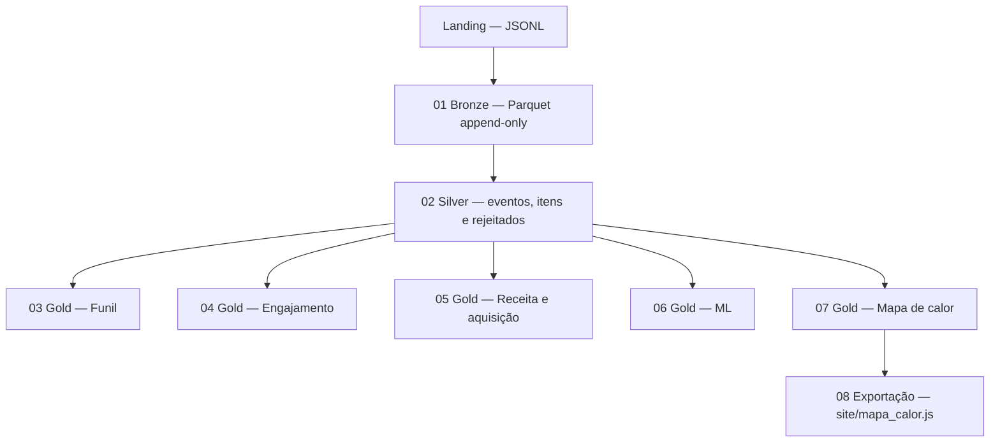

# DadosPro — Pipeline de engenharia de dados

Pipeline de eventos de navegação e comércio eletrônico, implementado em Python com PySpark 4.2.0, Docker e armazenamento S3 compatível (Floci). A arquitetura Medalhão transforma eventos brutos em dados tratados e produtos analíticos.

## Arquitetura e requisitos



O pipeline utiliza exclusivamente Spark e o conector Hadoop S3A para ler e gravar dados no datalake (R1). O SDK boto3 é utilizado pela infraestrutura, pelo gerador e pelo gerenciamento de recursos do Explorador, não pelos jobs de transformação. Cada job verifica suas dependências antes de processar (R2). O executor sequencial atende ao R3 independentemente do Workflow visual.

Consulte o [enunciado](../docs/ENUNCIADO.md) e o [SETUP](../SETUP.md).

## Preparação do ambiente

Execute os comandos a partir da raiz do projeto, com Docker Desktop ativo:

```powershell
docker compose up -d floci
```

O Compose utiliza `datalake-tracking-integrado` como bucket padrão para app e explorador. Para uma instalação nova, recomenda-se preparar o ambiente com o bucket original previsto pelo material didático, evitando depender dos dados locais utilizados durante a validação:

```powershell
$env:AWS_S3_BUCKET = 'datalake-tracking'
docker compose run --rm app python gerador/gerar_eventos.py
docker compose run --rm app python infra/verificar_ambiente.py
```

O gerador deve ser executado para preparar uma landing nova, não como parte de cada execução do pipeline. Confira o bucket e as mensagens do verificador antes de prosseguir. A sequência de instalação limpa com a configuração final deve ser conferida no ambiente de entrega.

Para voltar ao bucket padrão integrado, remova a variável da sessão PowerShell (`Remove-Item Env:AWS_S3_BUCKET`). O bucket integrado precisa existir e conter a landing antes de executar o pipeline. Os buckets locais não são transportados automaticamente com o código-fonte.

## Jobs implementados

| Script | Entrada | Saída |
| --- | --- | --- |
| `01_bronze_ingestao.py` | Landing | Bronze |
| `02_silver_eventos.py` | Bronze | Silver, itens e rejeitados |
| `03_gold_funil.py` | Silver | Funis de compra e lead |
| `04_gold_engajamento.py` | Silver | Sessões, vídeo, FAQ, saídas e downloads |
| `05_gold_receita_aquisicao.py` | Silver | Receita, reembolso, order bump e conversão de leads |
| `06_gold_ml.py` | Silver | Propensão, métricas e segmentação |
| `07_gold_mapa_calor.py` | Silver | Mapas de cliques e rolagem |
| `08_exportar_mapa_calor.py` | Gold de mapa de calor | `site/mapa_calor.js` |

### Execução individual

Exemplo, após preparar a landing:

```powershell
docker compose run --rm app python pipeline/01_bronze_ingestao.py
```

Substitua o nome do script pelo job desejado, respeitando suas dependências. Para selecionar explicitamente outro bucket em uma execução individual, use `docker compose run --rm -e AWS_S3_BUCKET=datalake-tracking app python pipeline/01_bronze_ingestao.py`.

### Execução sequencial completa (R3)

```powershell
docker compose run --rm app python pipeline/executar_pipeline.py
```

O executor chama os oito jobs em sequência, registra suas durações e interrompe o fluxo em caso de falha. Não gera eventos automaticamente.

**Atenção:** a Bronze é append-only. Reexecutar o pipeline sobre a mesma landing acrescenta registros à Bronze. A Silver deduplica por event_id. Não execute simultaneamente dois pipelines sobre o mesmo bucket. Use um bucket isolado para novos testes e não apague dados sem necessidade.

## Camadas e qualidade

### Bronze (R4)

Leitura JSONL com schema explícito, preservação do arquivo de origem e instante de ingestão. Escrita Parquet em append, com partições de evento e data de coleta.

### Silver (R5–R10)

- Deduplicação por `event_id`, priorizando a ingestão mais antiga e o arquivo de origem.
- Tipagem de timestamps e parâmetros, incluindo `element_id`, com conversões tolerantes a dados inválidos.
- Separação de eventos rejeitados, com um motivo por registro: timestamp inválido ou futuro, valor monetário inválido, marco fora do padrão, evento fora do catálogo, reembolso sem compra e transação sem identificador. IDs ausentes também são tratados.
- Sessões por identificador pseudônimo e intervalo de inatividade superior a 30 minutos, sem depender de `session_hint`.
- Resolução retroativa de identidade a partir dos identificadores conhecidos.
- Explosão dos itens em registros individuais, preservando a associação ao evento e à sessão.

Estrutura física:

```text
landing/event_name=scroll/year=2026/month=09/day=03/*.jsonl
bronze/event_name=scroll/year=2026/month=09/day=03/*.parquet
silver/event_name=scroll/year=2026/month=09/day=03/*.parquet
silver/itens/year=2026/month=09/day=03/*.parquet
silver/eventos_rejeitados/*.parquet
gold/<tabela>/*.parquet
```

As partições dos eventos ficam diretamente na raiz de cada camada. A leitura usa `basePath` e o glob `event_name=*`, evitando misturar eventos com itens e rejeitados. A inferência de tipos das partições é desativada para preservar os dois dígitos de mês e dia. A escrita dinâmica das partições Silver preserva as pastas vizinhas; em mudanças de universo de partições, deve-se conferir se não restaram partições antigas.

### Gold — 15 tabelas

| Job | Tabelas e finalidade |
| --- | --- |
| Funil | `funil_compra`: etapas e conversões por plano/canal; `funil_lead`: visita, rolagem e geração de lead |
| Engajamento | `sessoes`: indicadores por sessão; `retencao_video`: alcance dos marcos; `buscas_faq`: buscas e ausência de resultados; `saidas_downloads`: destinos externos e arquivos |
| Receita e aquisição | `receita_diaria`: receita bruta, reembolsos, líquida e ticket; `taxa_reembolso`: pedidos reembolsados por plano/canal; `adesao_order_bump`: adesão à mentoria; `lead_para_compra`: conversão e tempo até compra |
| ML | `propensao_sessao`: probabilidades e classificação; `metricas_modelo`: avaliação no teste; `segmentos_visitantes`: agrupamentos de visitantes |
| Mapa de calor | `mapa_calor_cliques`: cliques por página/elemento; `mapa_calor_rolagem`: alcance dos marcos na landing |

Os cinco jobs Gold leem a Silver de forma independente. A exportação depende exclusivamente das duas tabelas do mapa de calor.

## Machine learning

A propensão utiliza Random Forest com atributos de comportamento na landing anteriores ao primeiro carrinho. A divisão determinística em treino, validação e teste agrupa sessões pela chave de visitante utilizada pelo modelo (prioritariamente o pseudônimo). O limiar é selecionado pelo F1 da validação; o teste é reservado para avaliação final. São registrados AUC-ROC, precisão, recall, F1 e matriz de confusão.

A segmentação utiliza K-means, com comparação de k=3, 4 e 5 pela silhueta. Os segmentos são descritivos e podem incluir resultados de compra e lead. Não constituem um modelo de previsão em tempo real. Os dados são sintéticos e os resultados não demonstram generalização para clientes reais.

## Explorador e Workflow

```powershell
docker compose up -d explorador
```

Abra http://localhost:8501. No Data Catalog, confira o bucket selecionado e as camadas. Em **Jobs ETL**, sincronize os scripts com o bucket `glue-assets` antes de executá-los. O console utiliza a cópia sincronizada no Floci e registra status, duração e log. A sincronização pode remover recursos remotos que não existem mais localmente; confira as alterações antes de confirmar.

O Workflow `medalhao` está definido em `pipeline/workflows/medalhao.json`. Bronze precede Silver; os cinco jobs Gold dependem de Silver; a exportação depende do mapa de calor. O paralelismo máximo é dois jobs. A definição local também pode ser executada pelo terminal:

```powershell
docker compose run --rm app python -m explorador.workflows pipeline/workflows/medalhao.json
```

O Workflow é complementar ao executor sequencial exigido no R3. Não inicie ambos ao mesmo tempo no mesmo bucket. Em computadores com memória limitada, o paralelismo pode aumentar a duração em vez de reduzi-la.

Consulte a [documentação do Explorador](../explorador/README.md).

## Exportação para o site (R11)

Após gerar as tabelas Gold do mapa de calor:

```powershell
docker compose run --rm app python pipeline/08_exportar_mapa_calor.py
```

O job lê as duas tabelas via Spark, coleta somente os resultados agregados e grava `site/mapa_calor.js` no formato `window.MAPA_CALOR = {...};`, incluindo a data de geração UTC. O arquivo é gerado localmente, não no S3. Abra `site/index.html` e selecione **Mapa de calor**. Recarregue a página após nova exportação.

## Biblioteca comum e cuidados técnicos

`comum.py` centraliza a SparkSession, os caminhos S3A, a leitura e escrita particionadas e a verificação de dependências. As principais funções são `criar_sessao`, `caminho`, `glob_eventos`, `ler_eventos`, `gravar_eventos`, `exigir_camada`, `titulo` e `arquivo_do_projeto`.

O Spark 4 utiliza modo ANSI. Conversões de dados potencialmente inválidos devem utilizar `try_cast` e `try_to_timestamp`; divisões com denominador possivelmente zero devem utilizar `try_divide` ou tratamento equivalente. Não utilize `collect()` para transportar toda a Bronze ou Silver ao processo Python.

## Validação realizada

Na execução sequencial integrada de 26/11/2026, os oito jobs foram concluídos em aproximadamente 45 minutos e 10 segundos, antes da padronização dos nomes dos scripts. Foram auditadas 15 tabelas Gold não vazias. A Bronze recebeu 64.372 registros; a Silver identificou 656 duplicatas excedentes, 61.813 eventos aceitos, 1.903 rejeitados, 8.793 sessões e 24.427 itens. Um teste separado de dupla ingestão confirmou o comportamento append-only e a deduplicação.

Após a padronização, a compilação dos scripts, a definição local e remota do Workflow e o catálogo de oito jobs foram validados. A exportação pelo Explorador concluiu com sucesso, produzindo 24 elementos e cinco marcos de rolagem. A execução completa pelo orquestrador foi iniciada, mas seu resultado final ainda não está registrado nesta versão da documentação.

Os resultados analíticos e as recomendações de negócio são apresentados separadamente no `RELATORIO.md`.
